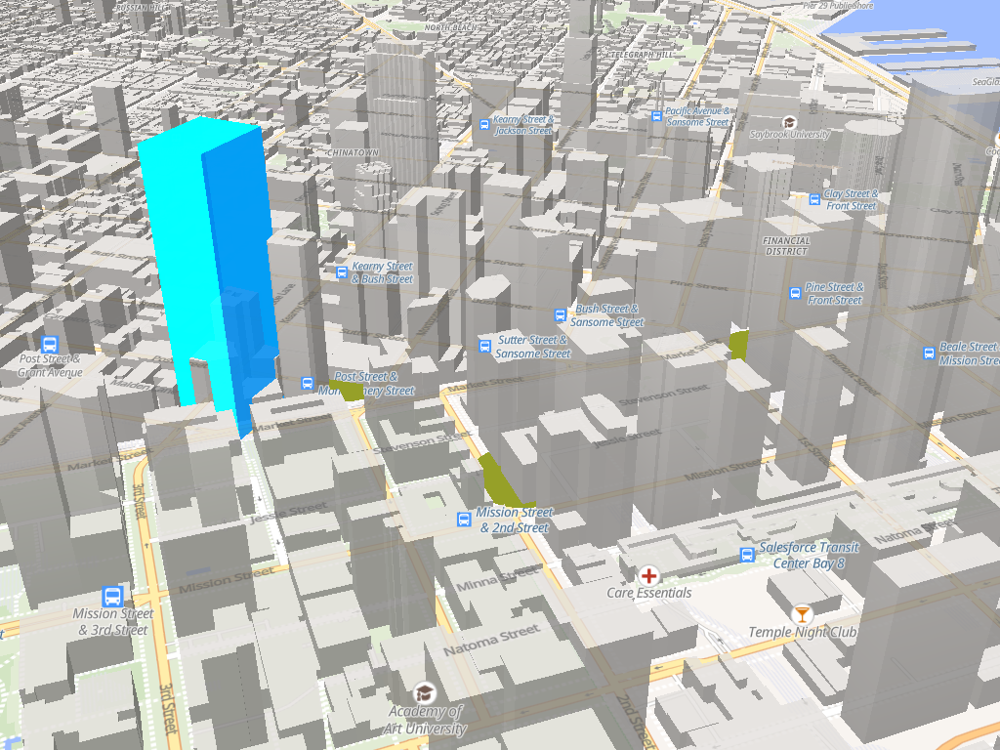
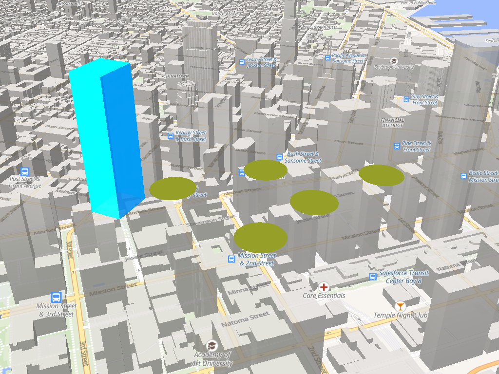

# deckgl-rs on mln-rs

deck layers drawn into a [mln-rs](https://github.com/louwers/mln-rs) basemap: one wgpu
device, one texture, all Rust.

[`examples/maplibre-ffi`](../maplibre-ffi) does the same thing against the C++
maplibre-native: wgpu-hal adopts the map's `MTLDevice`, an Objective-C++ shim carries the
frame over a C ABI, and the camera crosses a thread boundary through a mutex. mln-rs is a
Rust port of that same engine on the same wgpu version, so here the exchange is three
calls and no FFI at all:

| | |
| --- | --- |
| share the GPU | `mln_rs::Device::webgpu(instance, device, queue, format)` |
| render the map on it | `HeadlessFrontend::with_device(device, size, ..)` |
| reach the frame | `frontend.target().frames()` → `begin_frame()` → `as_webgpu()` → `TargetResource` |

`TargetResource` gives the colour view, the depth-stencil view and both formats, which is
everything deck needs to record into the same attachments.

## Running it

It needs a checkout of mln-rs beside this repository, which is why the crate is its own
workspace and excluded from the root one:

```sh
git clone https://github.com/louwers/mln-rs ../../../mln-rs
cargo run -p deckgl-mln-demo -- out.png     # from examples/mln
```

mln-rs is edition 2024 with a 1.98 MSRV, above this repository's own.

| variable | effect |
| --- | --- |
| `DECKGL_MLN_STYLE=<url>` | load a real style instead of the built-in background, e.g. `https://tiles.openfreemap.org/styles/liberty` |
| `DECKGL_MLN_DEPTH=0` | draw deck on top instead of sharing the map's depth buffer |



*deck's cyan tower cut into by the buildings in front of it, and its olive ground circles
surviving only in the gaps between them. Basemap: OpenFreeMap Liberty, rendered by mln-rs.*

The same frame with `DECKGL_MLN_DEPTH=0`, where deck ignores the map's depth buffer, shows
what the depth sharing is worth: every circle is a whole ellipse floating over the city and
the tower stands in front of everything.



## State

Working: the device is shared, the map renders on it, deck draws into the texture and the
depth buffer the map rendered into, deck geometry is occluded by the map's buildings, and
the composite reads back through mln-rs as one image.

Sharing the depth buffer took two corrections, both of which fall out of mln-rs being a
faithful port. Its `mat4::perspective` is the OpenGL one, writing `(far + near) / (near -
far)`, so clip z runs `[-1, 1]` and deck needs `ClipDepthRange::NegativeOneToOne`. And its
far plane is maplibre's `furthest_distance * 1.01`, so `maplibre_near_far_pixels` from the
FFI crate gives deck the same frustum. Without those, every deck fragment was rejected and
the layers vanished.

Occlusion needs a style that writes depth. The built-in one is a bare background, which
maplibre draws `Always` and `ReadOnly`, so it writes nothing and interleaved output is
byte-identical to drawing on top. Point `DECKGL_MLN_STYLE` at a style with a
`fill-extrusion` layer, such as Liberty's `building-3d`, and the buildings occlude deck.

`HeadlessFrontend::target()`, which this needs to reach the frame, is upstream as of
[louwers/mln-rs#211](https://github.com/louwers/mln-rs/pull/211). No patched checkout
is required.

Still open upstream: `SurfaceTarget::set_overlay` hands an overlay only the colour view,
so the windowed path cannot depth-test against the map the way this headless one does.
Adding the depth-stencil view and format to `OverlayTarget` would close that gap.
